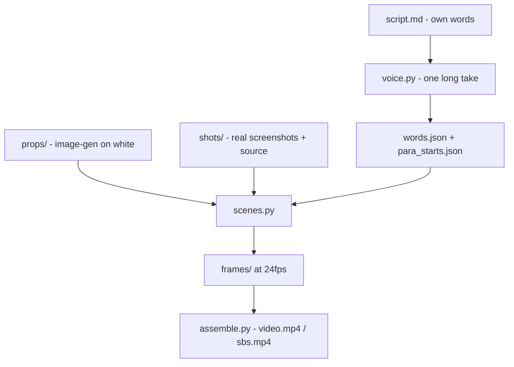

# stick-video

Pipeline: script -> one voice take -> word timings -> scenes keyed to those words -> frames -> mp4.
Everything lives in a project dir (e.g. `~/Desktop/<topic>-stick/`). Kit: `scripts/stickkit.py`.

## Requirements

- **Voice:** `GEMINI_API_KEY` set in the environment (`voice.py` calls the Gemini TTS API directly; override the model with `GEMINI_TTS_MODEL`).
- **Props:** any image generator that can make doodles on a white background (the optional `image-gen` skill from this repo works).
- **Word timings:** `whisper-cli` (`brew install whisper-cpp`) plus one ggml model, e.g. `ggml-large-v3-turbo.bin` in `/opt/homebrew/share/whisper.cpp/models/`.
- **Render:** `ffmpeg` and Python 3 with Pillow (`pip install pillow`).
- macOS assumed (`open`, Homebrew paths).

## Characters

| Character | Look | Voice | Draw with |
|---|---|---|---|
| **Pip** | Orange beanie with pom, round glasses | `Puck` | `pip()` (stickkit) |
| **Normal guy** | Teal beanie with a knitted stripe, round glasses | `Umbriel` | `normal_guy()` (cast) |
| **Cool guy** | Charcoal beanie with a knitted stripe, wraparound mirrored shades, smirk | `Algieba` | `cool_guy()` (cast) |

Voices are Gemini prebuilt voice names; any can be overridden.

- **Pip** is the default solo host.
- **The normal guy and the cool guy are two separate characters, not one guy with a costume change.**
  - They take turns narrating (see Dialogue mode), and whoever is speaking is the one on screen.
  - Both can appear together on a title card or at the end.
- Keep each one's voice, beanie color and the cool guy's shades consistent within a video.
- `from cast import *` after `from stickkit import *`.
- Both default to a wide stance with arms crossed. Other poses: `**HIPS`, `**POINTING`, or any `arms=(...)` preset.
- The shades are drawn generically: oversized wraparound shield, rainbow mirror lens, no brand.
- `ppip(..., black=True, cool=True)` is the underlying drawer if you need a one-off mix.

## Rules - originality

- **Own character.** Use Pip, the cast, or design a new original one. Never redraw a channel's mascot or any known character, even "close enough".
- **Own words.** Facts and structure from sources are fine. Narration is written fresh, never a reference video's transcript re-voiced or lightly paraphrased.
- **Replicating a reference video** = match its beats, pacing, cut rate, layout ideas and look. Not its script, character, or drawings.
- **Screenshots are real.** Capture actual charts/headlines (headless browser, or download the image), crop to the headline or chart, and caption every one via `card(..., source=...)`. Never fabricate a headline or mimic an outlet's branding. Short excerpts only, not article bodies.
- **Logos:** write company names in hand lettering rather than pasting trademark logos.
- **Real brand GIFs:** an animated asset a team already ships (e.g. your own product's animated mascot) can play via `gif_card()`. Copy it into `props/` and never alter it.

## Steps

1. **Research + script.** Gather facts and real sources. Write `script.md`: one paragraph per beat, blank line between. ~150 words/min.
2. **Voice:** `python3 ~/.claude/skills/stick-video/scripts/voice.py script.md [-v Puck]`
   One continuous Gemini TTS take, never per-line clips (per-line resets the voice and sounds choppy). Whisper gives `words.json`; `para_starts.json` = each paragraph's start. Check the printed alignment - fix any WARN by hand.
3. **Props:** `imagegen "<thing>. simple hand-drawn cartoon doodle, thick wobbly black marker outlines, flat bright colors, plain pure white background, no text, centered, single object" 2`. Pick one, trim, save `props/<name>.png`. Push near-white to pure white (they composite by multiply, so any off-white shows as a box).
4. **Screenshots:** save to `shots/`, note the source for each.
5. **Scenes:** copy `templates/scenes.py`. Each scene is `S_x(p, t)`; `SCENES = [(start, fn), ...]` with starts from `P[i]`. Key pop-ins to speech: `pop(t, word_at("trillion", after=P[2]))`.
   Cut every ~1.5-3s like real explainers - several scenes per paragraph, not one.
6. **Check stills:** `python3 scenes.py --still 3 9 15 ...`, tile and look. Fix overlaps, clipped text, off-white boxes.
7. **Render:** `python3 scenes.py` (multiprocess, ~25s per 2 min), then `python3 .../assemble.py [--intro-sfx pop.wav] [--ref ref.mp4 --ref-start S]` -> `video.mp4` (+ `sbs.mp4`). Open it. `--intro-sfx` plays a sound at 0s and delays the voice by `--sfx-lead` (0.2s).

## Dialogue mode (two hosts)

1. Write `script.md` with one paragraph per turn, each starting with the speaker's name: `cool: ...` / `normal: ...`.
Alternate turns, and give the cool guy the punchy lines.
2. Run `python3 ~/.claude/skills/stick-video/scripts/dialogue.py script.md` instead of `voice.py`.
   - It records **one continuous take per speaker**, each in that speaker's own voice and style. This keeps each voice consistent.
   - It cuts each take at whisper's paragraph starts and concatenates the turns in order.
   - It writes the same `vo_full.m4a`, `words.json` and `para_starts.json`, plus `speakers.json`.
   - Override a voice with `--voice cool=Algieba`.
3. In `scenes.py`, load `SPK = json.load(open("speakers.json"))` and draw the narrator with `host(p, t, P, SPK, x, y, s, ...)`. It picks the cool or normal guy by whoever is speaking at `t`. Draw `normal_guy()` / `cool_guy()` directly to show both at once.
4. Whisper hears the two voices differently, so check `words.json` before keying `word_at()` (e.g. "Acme's" can come back as `acmes` or a lookalike).

## Gen Z mode

Gen Z mode adds a small, looping, muted B-roll clip (the classic endless-runner gameplay style) in the bottom-right corner.
**You must supply your own B-roll file.** No footage is bundled or downloaded; use only footage you made or are licensed to use. `--genz` exits with an error if `--broll` is missing.
Run it after the normal render: `python3 ~/.claude/skills/stick-video/scripts/assemble.py --genz --broll /path/to/your-clip.mp4 [--genz-width 150]`.
It writes `video-genz.mp4` and leaves `video.mp4` alone, so you can ship both.
**Vertical (9:16) frames get a split-screen instead of the corner box.** In a vertical video, TikTok/Reels/Shorts UI covers the bottom-right corner (buttons) and the bottom edge (caption), so the scene is scaled to 78% at the top and the B-roll fills a full-width band below it. The bullets below describe the 16:9 layout.

- **Bottom-right, on purpose.** That is where viewers already expect picture-in-picture (OS and browser PiP windows, streamer facecams), and a frame is read from the top-left, so the distraction sits where attention ends instead of fighting each scene's opening.
- **It never covers text or drawings, and it never moves.** The rendered frame is scaled down about 15% and shifted left on the white canvas, which leaves a gutter on the right. The clip sits in that gutter, fixed in the bottom-right, for the whole video. You don't need to lay out scenes around it, and it works on a video you already made, since it reuses `frames/`.
- **Small by default:** 150px wide, with rounded corners and a feathered edge.
- **B-roll audio never plays.** The clip is read with `-an` and only the voiceover track is mapped, so any B-roll you swap in stays silent too.
- **No default clip:** `--broll` is required. Any video works; it is looped and muted.
- Check a couple of stills of `video-genz.mp4` before sending.

## Kit reference (stickkit.py)

- `pip(p, x, y, s, arms=(L,R), mouth=smile|grin|o|flat|frown|smirk, eyes=dot|wide|closed|squint, pointer=(hand, (x,y)), look=(dx,dy), blush)` - x,y = feet. Arm presets `A_DOWN_*`, `A_HIP_*`, `A_POINT_*`, `A_UP_*`, `A_CHIN_R`, `A_SHRUG_*`, `A_WAVE_R`.
- `stick(...)` generic extras. `bubble(... tail=None)` for thought bubbles. `chalkboard`, `balance(ang)`, `arrow(prog)`, `bar(prog)`, `doodle_pc/globe/phone`.
- `p.text(s, x, y, size, font=HAND|BANG|MARK|GOCHI, color, scale=pop(...), rot, stroke)`, `p.image(prop, cx, cy, h, scale, rot)`, `card(p, path, cx, cy, w, source)`.
- `gif_card(p, t, "props/x.gif", cx, cy, w, t0)` plays an animated GIF in real time as a rounded card that pops in at `t0`.
- `cast.py`: `normal_guy`, `cool_guy`, `host`, `speaker_at`, the presets `CROSSED`/`HIPS`/`POINTING`, and `VOICES` (each guy's voice and style string).
- Vertical 9:16: call `set_canvas(720, 1280)` before `run()`.
- Lines "boil" (redraw jitter at 8fps) automatically; keys keep each stroke's jitter stable.
- Canvas 1280x720 drawn at 2x. Coordinates are 1280x720.

## Gotchas

- Whisper (small) sometimes drops a sentence from the transcript. The audio is fine; `word_at` raises if a word is missing - pick a neighbor word.
- Fonts ship in `fonts/` (OFL / Apache, see `fonts/OFL.txt`). ffmpeg here has no drawtext - all text goes through Pillow.
